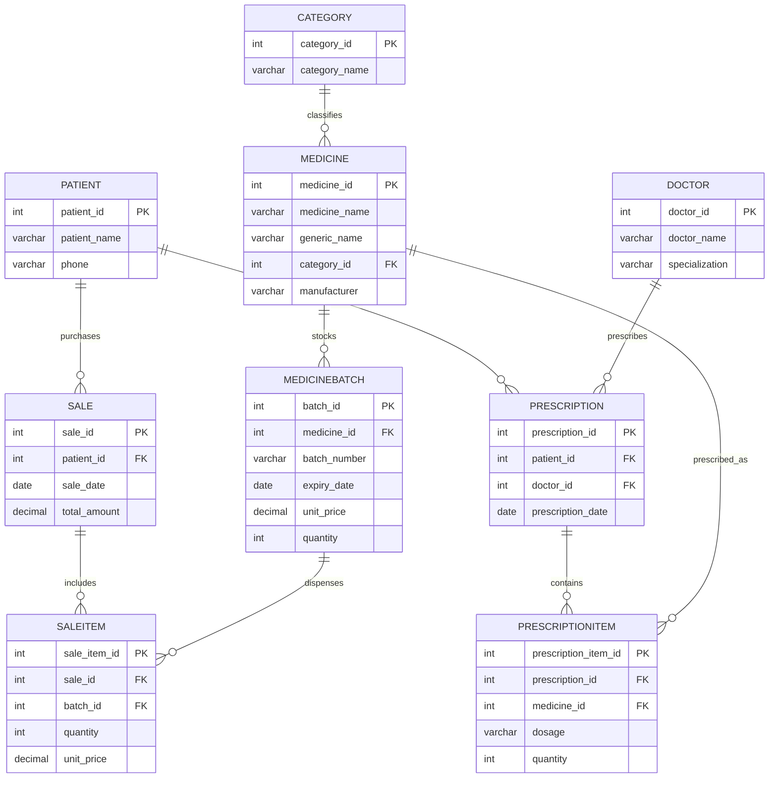
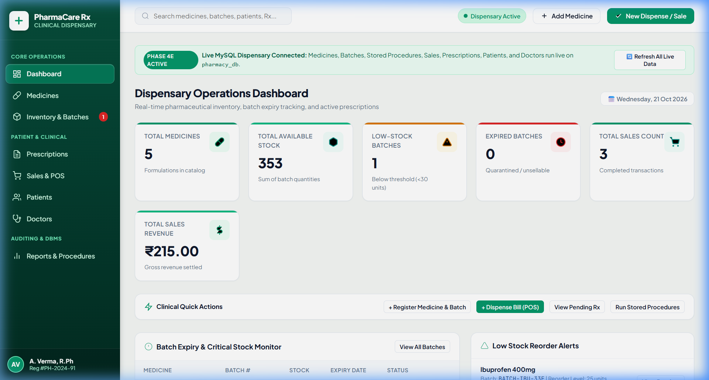
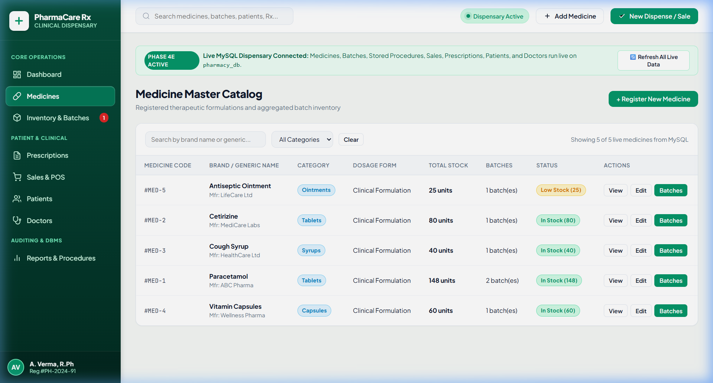
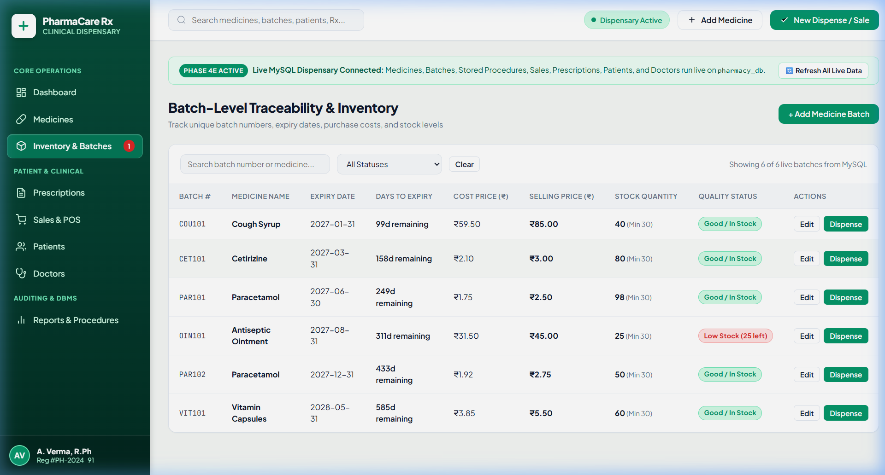
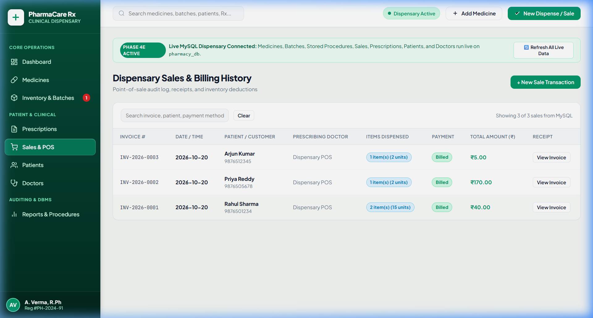
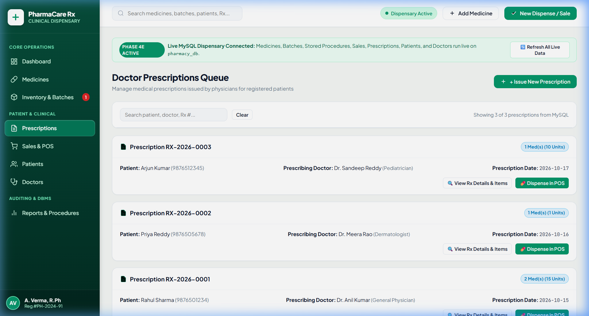
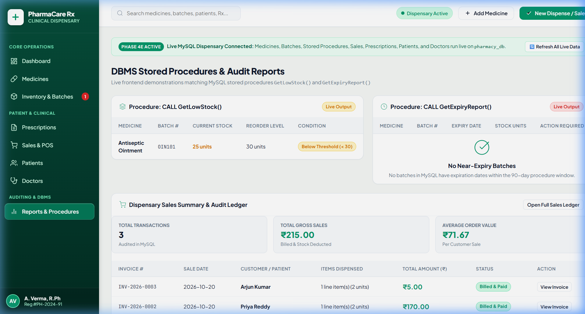

# 🏥 Pharmacy Inventory and Prescription Management System

[]()
[]()
[]()
[]()
[]()
[]()

---

## 1. Project Overview

The **Pharmacy Inventory and Prescription Management System** is a full-stack Database Management Systems (DBMS) Mini Project developed for **Geethanjali College of Engineering and Technology** under course code **25CS21003 (Database Management Systems)**.

The system provides hospital dispensaries and clinical pharmacies with an end-to-end relational database solution to manage pharmaceutical formulations, track shipment batches under **First-Expiry, First-Out (FEFO)** guidelines, record doctor prescriptions, maintain patient and doctor directories, and bill point-of-sale (POS) dispensary transactions with automated database trigger-enforced stock deductions.

---

## 2. Problem Statement

Hospital and retail pharmacies face significant inventory management and compliance challenges:
1. **Medication Expiry Wastage**: Dispensing newer stock while older batches expire on shelves results in severe clinical hazards and financial loss.
2. **Accidental Overselling & Stock Discrepancies**: Manual record-keeping leads to dispensing unrecorded or out-of-stock medication.
3. **Prescription Traceability**: Disconnection between doctor prescriptions, patient records, and dispensed medication items impedes clinical auditing.
4. **Data Redundancy & Update Anomalies**: Un-normalized schemas cause repeated data entry, orphaned records, and inconsistent pricing.

---

## 3. Project Objectives

- Design a **3NF-normalized MySQL 8.0 relational schema** that models clinical pharmacy operations without redundancy.
- Enforce inventory integrity at the database layer using **MySQL Triggers** (`BEFORE INSERT` and `AFTER INSERT`) to validate available stock and automatically deduct batch quantities upon sale.
- Implement **MySQL Stored Procedures** for real-time compliance reporting (low-stock alerts below 30 units and near-expiry batch auditing within a 90-day window).
- Guarantee **ACID transaction safety** with rollback on failure for multi-item sales and prescription creation.
- Provide a responsive clinical user interface connected to RESTful Node.js/Express APIs.

---

## 4. Technologies Used

| Layer | Technology | Purpose |
| :--- | :--- | :--- |
| **Database** | MySQL 8.0 (`pharmacy_db`) | 3NF relational data store, foreign keys, triggers, stored procedures |
| **DB Driver** | `mysql2/promise` (v3.11.0) | High-performance pooled MySQL connection with async/await |
| **Backend Runtime** | Node.js (v18+) & Express (v4.21.0) | RESTful API server, transaction coordinator, business logic |
| **Environment** | `dotenv` (v16.4.5) | Secure credential separation via `.env` |
| **CORS** | `cors` (v2.8.6) | Cross-origin resource sharing middleware |
| **Frontend** | HTML5, Vanilla CSS3, JavaScript | Single-page application, modal workflows, live data rendering |

---

## 5. Implemented Features

* **Real-time Operations Dashboard**:
  - Live scalar summary cards: Total Medicines, Total Available Stock (sum of batch quantities), Low-Stock Batches (< 30 units), Expired Batches (< today), Total Sales Count, and Total Sales Revenue.
  - Urgent alerts feed for batches expiring within 30 days or below reorder levels.
  - Recent sales activity table with customer and item summaries.
* **Medicine Formulation Management**:
  - Catalog of therapeutic medicines with generic names, dosage forms, and therapeutic categories.
  - Search by medicine name and manufacturer.
  - Create and edit medicine formulations with immediate MySQL persistence.
* **Batch-Level Inventory & FEFO Tracking**:
  - Tracks individual shipment batches with unique batch numbers, purchase costs, selling prices, and expiration dates.
  - Dynamically calculates days to expiry for First-Expiry, First-Out (FEFO) dispensing.
  - Stock level progress bars indicating inventory health against reorder thresholds.
* **Point-of-Sale (POS) Dispensary Billing**:
  - Dispense single or multi-item medication orders to registered patients or walk-in customers.
  - Automatic validation against overselling and expired medications.
  - Automated stock deduction and sale total accumulation via database triggers.
  - View full modal invoice receipts with breakdown of line items.
* **Doctor Prescription Registry**:
  - Issue electronic doctor prescriptions linked to patients and licensed physicians.
  - Prescribe multiple medication line items with custom dosage instructions.
  - Zero unintentional inventory deduction during prescription creation (stock is deducted only upon POS dispensing).
* **Patient & Doctor Management**:
  - Patient directory with contact numbers and medical history search.
  - Prescribing physician registry with medical specializations and contact numbers.
  - Add and edit profiles with immediate dropdown synchronization in sales and prescriptions.
* **DBMS Stored Procedure Auditing**:
  - Low-stock audit report executing `CALL GetLowStock()` (threshold < 30 units).
  - Expiry audit report executing `CALL GetExpiryReport()` (90-day FEFO window).
  - Dispensary sales ledger with gross revenue, average order value, and line item counts.

---

## 6. Database Schema & Relationships

The database `pharmacy_db` consists of 9 normalized tables structured in Third Normal Form (3NF):



### Table Dictionary
1. **`category`**: Therapeutic classes (e.g., Tablets, Capsules, Syrups, Ointments, Injections).
2. **`medicine`**: Medication formulations linked to categories (`category_id` FK).
3. **`medicinebatch`**: Physical inventory batches linked to medicines (`medicine_id` FK) with quantity, price, and expiry date.
4. **`patient`**: Patient contact directory (`patient_id`, `patient_name`, `phone`).
5. **`doctor`**: Licensed prescribing doctors (`doctor_id`, `doctor_name`, `specialization`).
6. **`prescription`**: Prescription header linking patient and doctor (`patient_id` FK, `doctor_id` FK).
7. **`prescriptionitem`**: Associative junction table resolving Many-to-Many relationship between `prescription` and `medicine`.
8. **`sale`**: Point-of-sale invoice header linking customer (`patient_id` FK) with transaction date and total amount.
9. **`saleitem`**: Associative junction table resolving Many-to-Many relationship between `sale` and `medicinebatch`.

---

## 7. Database Triggers & Stored Procedures

### Triggers in `pharmacy_db`

#### 1. `check_sale_stock` (BEFORE INSERT on `saleitem`)
Enforces clinical safety and prevents inventory overselling at the database engine level.
```sql
CREATE TRIGGER check_sale_stock
BEFORE INSERT ON saleitem
FOR EACH ROW
BEGIN
    DECLARE available_stock INT;
    DECLARE batch_exp DATE;

    SELECT quantity, expiry_date INTO available_stock, batch_exp
    FROM medicinebatch WHERE batch_id = NEW.batch_id;

    IF available_stock < NEW.quantity THEN
        SIGNAL SQLSTATE '45000'
        SET MESSAGE_TEXT = 'Insufficient stock for this batch';
    END IF;

    IF batch_exp < CURDATE() THEN
        SIGNAL SQLSTATE '45000'
        SET MESSAGE_TEXT = 'Cannot sell expired medicine';
    END IF;
END;
```

#### 2. `after_saleitem_insert` (AFTER INSERT on `saleitem`)
Automatically synchronizes inventory quantities and accumulates invoice totals upon sale item insertion.
```sql
CREATE TRIGGER after_saleitem_insert
AFTER INSERT ON saleitem
FOR EACH ROW
BEGIN
    -- Deduct stock from medicinebatch
    UPDATE medicinebatch
    SET quantity = quantity - NEW.quantity
    WHERE batch_id = NEW.batch_id;

    -- Accumulate gross total in sale
    UPDATE sale
    SET total_amount = total_amount + (NEW.quantity * NEW.unit_price)
    WHERE sale_id = NEW.sale_id;
END;
```

### Stored Procedures in `pharmacy_db`

#### 1. `GetLowStock()`
Retrieves all batches whose quantity has fallen strictly below 30 units:
```sql
CREATE PROCEDURE GetLowStock()
BEGIN
    SELECT m.medicine_name, b.batch_number, b.quantity
    FROM medicinebatch b
    JOIN medicine m ON b.medicine_id = m.medicine_id
    WHERE b.quantity < 30;
END;
```

#### 2. `GetExpiryReport()`
Audits batches nearing expiration within the 90-day window or already expired:
```sql
CREATE PROCEDURE GetExpiryReport()
BEGIN
    SELECT m.medicine_name, b.batch_number, b.quantity, b.expiry_date
    FROM medicinebatch b
    JOIN medicine m ON b.medicine_id = m.medicine_id
    WHERE b.expiry_date <= DATE_ADD(CURDATE(), INTERVAL 90 DAY);
END;
```

---

## 8. Backend REST API Endpoints

Base URL: `http://localhost:5000/api`

| Module | Method | Endpoint | Description |
| :--- | :---: | :--- | :--- |
| **System** | `GET` | `/health` | Server status and live MySQL connectivity check |
| **Medicines** | `GET` | `/medicines` | List all medicines with total stock and batch counts (`?search=`, `?category=`) |
| | `GET` | `/medicines/categories` | List therapeutic categories |
| | `GET` | `/medicines/:id` | Fetch single medicine with associated batches |
| | `POST` | `/medicines` | Register new formulation (with optional initial batch) |
| | `PUT` | `/medicines/:id` | Update formulation details |
| **Batches** | `GET` | `/batches` | List inventory batches with calculated days-to-expiry and FEFO status |
| | `POST` | `/batches` | Add new batch for a medicine |
| | `PUT` | `/batches/:id` | Update batch pricing and expiration |
| | `DELETE` | `/batches/:id` | Delete batch (protected against batches with sales) |
| **Sales (POS)** | `GET` | `/sales` | List historical sales transactions (`?limit=`, `?offset=`) |
| | `GET` | `/sales/patients` | Patient dropdown list for billing |
| | `GET` | `/sales/:id` | Fetch single sale invoice with line items |
| | `POST` | `/sales` | Record dispensary sale transaction (atomic transaction + triggers) |
| **Prescriptions** | `GET` | `/prescriptions` | List doctor prescriptions (`?search=`, `?limit=`) |
| | `GET` | `/prescriptions/:id` | Fetch prescription with prescribed items |
| | `POST` | `/prescriptions` | Issue new prescription with line items |
| **Patients** | `GET` | `/patients` | List patients with optional `?search=` |
| | `GET` | `/patients/:id` | Fetch single patient by ID |
| | `POST` | `/patients` | Register new patient |
| | `PUT` | `/patients/:id` | Update patient record |
| **Doctors** | `GET` | `/doctors` | List doctors with optional `?search=` |
| | `GET` | `/doctors/:id` | Fetch single doctor by ID |
| | `POST` | `/doctors` | Register new doctor |
| | `PUT` | `/doctors/:id` | Update doctor profile |
| **Reports** | `GET` | `/reports/dashboard-summary` | Real-time non-duplicative scalar dashboard metrics |
| | `GET` | `/reports/sales-summary` | Sales metrics (total sales, gross sales, AOV) + recent sales audit |
| | `GET` | `/reports/low-stock` | Runs stored procedure `CALL GetLowStock()` (< 30 units) |
| | `GET` | `/reports/expiry` | Runs stored procedure `CALL GetExpiryReport()` (90-day window) |

---

## 9. Project Directory Structure

```text
Pharmacy_Inventory/
├── database/                          # MySQL 8.0 Database Scripts
│   ├── schema.sql                     # DDL: 9 tables, primary/foreign keys, triggers, procedures
│   ├── sample_data.sql                # DML: Baseline sample records for testing
│   └── test_queries.sql               # Verification queries and trigger testing scripts
│
├── backend/                           # Node.js + Express REST API Server
│   ├── config/
│   │   └── db.js                      # DB configuration alias
│   ├── routes/
│   │   ├── medicineRoutes.js          # Medicine catalog endpoints
│   │   ├── batchRoutes.js             # Batch inventory endpoints
│   │   ├── salesRoutes.js             # POS billing endpoints
│   │   ├── prescriptionRoutes.js      # Prescription endpoints
│   │   ├── patientRoutes.js           # Patient management endpoints
│   │   ├── doctorRoutes.js            # Doctor management endpoints
│   │   └── reportRoutes.js            # Dashboard summary & stored procedure endpoints
│   ├── .env.example                   # Local environment variable template
│   ├── db.js                          # mysql2 connection pool with error handling
│   ├── package.json                   # Dependencies and test script definitions
│   ├── server.js                      # Express app entry point & static server
│   ├── test_all_workflows.js          # 14 essential workflows automated test runner
│   ├── test_dashboard_reports_api.js  # Dashboard & reports test suite
│   ├── test_medicine_api.js           # Medicine catalog test suite
│   ├── test_sales_api.js              # POS & trigger deduction test suite
│   ├── test_prescription_api.js       # Prescription management test suite
│   ├── test_patient_doctor_api.js     # Patient & doctor test suite
│   └── test_db_connection.js          # MySQL connection verification script
│
├── frontend/                          # Single-Page Application (SPA)
│   ├── css/
│   │   └── style.css                  # Clinical design system (emerald/forest theme)
│   ├── js/
│   │   └── app.js                     # Frontend logic, API fetchers, modal handlers, validation
│   └── index.html                     # Application single-page container
│
├── docs/                              # Academic Submission Documentation
│   ├── screenshots/                   # Genuine captured application screenshots
│   │   ├── 01_dashboard.png           # Operations dashboard
│   │   ├── 02_medicines.png           # Medicine formulation catalog
│   │   ├── 03_batches.png             # Batch inventory & FEFO tracker
│   │   ├── 04_sales.png               # POS sales history & ledger
│   │   ├── 05_prescriptions.png       # Doctor prescription queue
│   │   └── 06_reports.png             # Stored procedures & audit reports
│   ├── API_Documentation.md           # REST API specification & payloads
│   ├── DBMS_Viva_Questions.md         # Academic viva preparation & answers
│   └── ER_Diagram_notes.md            # Entity descriptions & cardinality notes
│
├── .env.example                       # Root environment configuration template
├── .gitignore                         # Excludes node_modules and .env secrets
└── README.md                          # Project documentation
```

---

## 10. Prerequisites

Before running the application, ensure the following software is installed on Windows:
* **Node.js**: v18.0.0 or higher ([Download Node.js](https://nodejs.org/))
* **MySQL Server**: 8.0 or higher ([Download MySQL Installer](https://dev.mysql.com/downloads/installer/))
* **Git**: Windows command-line git ([Download Git](https://git-scm.com/))
* **Web Browser**: Google Chrome, Microsoft Edge, or Mozilla Firefox

---

## 11. Windows Setup & Installation Instructions

### Step 1: Clone the Repository
Open PowerShell or Command Prompt:
```powershell
git clone https://github.com/amansheikh-techie/Pharmacy_Inventory.git
cd Pharmacy_Inventory
```

### Step 2: Initialize MySQL Database
1. Start MySQL Server (via Windows Services or MySQL Workbench).
2. Open PowerShell in the project root and load the schema and sample data:
```powershell
mysql -u root -p -e "CREATE DATABASE IF NOT EXISTS pharmacy_db;"
mysql -u root -p pharmacy_db < database/schema.sql
mysql -u root -p pharmacy_db < database/sample_data.sql
```
*(Enter your MySQL root password when prompted)*

---

## 12. Configuring MySQL Credentials (`.env`)

1. In the `backend/` directory, copy `.env.example` to create `.env`:
```powershell
copy backend\.env.example backend\.env
```
2. Open `backend/.env` in any text editor and configure your local MySQL password:
```ini
PORT=5000

# MySQL Database Settings
DB_HOST=localhost
DB_USER=root
DB_PASSWORD=your_actual_mysql_password_here
DB_NAME=pharmacy_db
DB_PORT=3306
```
> **Security Notice**: `backend/.env` is ignored by Git in `.gitignore` and is never committed to GitHub.

---

## 13. Installing Dependencies & Running the Application

### Step 1: Install Backend Dependencies
```powershell
cd backend
npm install
```

### Step 2: Test Database Connection
```powershell
npm run test:db
```
*Expected Output: `✓ MySQL Connection: SUCCESSFUL! Database: pharmacy_db on localhost`*

### Step 3: Start the Application Server
```powershell
npm start
```
*The server will start at `http://localhost:5000`.*

### Step 4: Access the Frontend
Open your web browser and navigate to:
👉 **`http://localhost:5000`**

### Step 5: Run Automated Test Suites
In a separate terminal window, run the automated test runners:
```powershell
# Run the 14 essential workflows verification
node backend/test_all_workflows.js

# Run dashboard & stored procedure reports verification
node backend/test_dashboard_reports_api.js

# Run full regression test suites
node backend/test_medicine_api.js
node backend/test_sales_api.js
node backend/test_prescription_api.js
node backend/test_patient_doctor_api.js
```

---

## 14. Application Screenshots

### 1. Operations Dashboard


### 2. Medicine Formulation Management


### 3. Inventory & Batch FEFO Tracker


### 4. Sales & POS Billing Ledger


### 5. Doctor Prescription Queue


### 6. Stored Procedures & Audit Reports


---

## 15. Known Limitations

1. **Currency**: All amounts are formatted in Indian National Rupee (`₹`), which satisfies the PBL curriculum specification.
2. **Batch Deletion Protection**: Batches with associated historical sales cannot be hard-deleted to preserve referential integrity in `saleitem`.
3. **Single Store / Local Deployment**: Designed as a departmental/hospital dispensary management system running on a local or intranet network. Multi-store enterprise synchronization is outside the project scope.

---

## 16. Academic Declaration

**Student Name**: Aman Sheikh  
**Institution**: Geethanjali College of Engineering and Technology  
**Department**: Department of Computer Science & Engineering  
**Subject**: Database Management Systems (25CS21003)  
**Project GitHub Repository**: [https://github.com/amansheikh-techie/Pharmacy_Inventory](https://github.com/amansheikh-techie/Pharmacy_Inventory)
